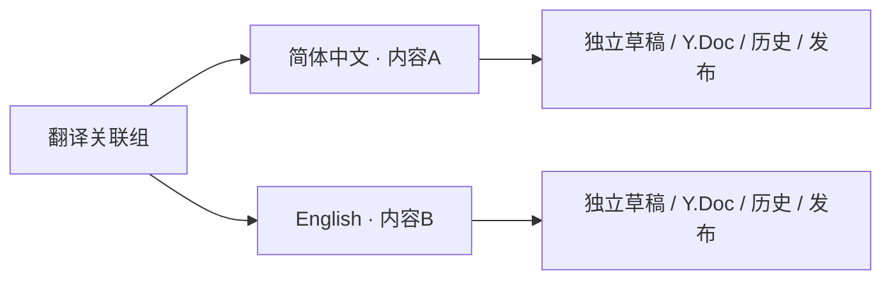

# 多语言内容与界面入口方案

版本：multilingual-design-1，2026-11-05（Asia/Shanghai）。状态：**约定复盘与工程提案，尚未实施**。用户本轮要求先回顾约定、考虑前后台入口，并已选择首批简体中文与英文；默认简体中文沿当次问题的选择。数据结构、接口名和界面细节在实施时按本方案细化，不能把示例当作已发布契约。

## 已确认约定及新选择

- 基线Q31：每种语言是独立内容ID、正文、SEO、历史、草稿和发布状态，以翻译组关联。基线主要举article/page，本轮用户明确将同一机制用于文章和说说；组内类型一致。
- Q59/Q65及后续协同决定：每个语言版本各有一个共享工作草稿和Y.Doc；已经发布的译文不被其他语言的实时编辑覆盖。当前离线分支与版本合并仍限于同一内容ID。
- Q26/Q31：创建译文草稿不公开该语言；切换和SEO仅暴露真实已发布、按策略可展示的版本。缺译文回可用原文，不生成占位翻译页面。
- Q35：界面语言与正文语言分开；公开SSR按显式URL解析，Cookie/浏览器偏好不覆盖显式URL。API有明确语言偏好，请求语言上下文相互隔离。
- Q36/Q37：前后端分别维护代码语言包；动态文章/分类/标签不使用静态t键模拟翻译。缺字符串按请求语言、基础语言、默认语言、完整键名回退并记录警告。
- 本轮首批：zh-CN（简体中文，默认）、en（English）；不是zh-CN/en-US，也不据此自动产生译文或自动翻译。

依据：[原始设计基线](../baseline/01_Design_Baseline_v2.11.md)的URL/多语言、Q31/Q35–37/Q52/Q57；[工程基线](../baseline/02_Engineering_Plan_v0.14.md)的内容身份、唯一约束及请求上下文。

## 当前代码盘点

| 位置 | 当前状态 | 实施需要补齐 |
| --- | --- | --- |
| 后端app/modules/content/draft_models.py | ContentDraft没有语言或翻译组 | 私有语言身份、关联、组并发约束 |
| 后端models.py/publication.py | Content有language，但发布写死zh-CN | 从工作版本发布真实语言，建立公开译文投影 |
| 后端draft_schemas.py/schemas.py | 私有DTO无关联；公开DTO只有单项language | 管理关系、列表筛选、公开可用译文和解析能力 |
| 后端repository.py | 内容/搜索查询无语言筛选 | 语言范围、按组择优、分页前去重 |
| 后端app/core/responses.py | 默认消息为中文，无app.core.i18n或语言包运行时 | 请求ContextVar、模块语言包、本地化msg |
| 前端src/app/layout.tsx | html.lang固定zh-CN | 由本次路由解析的语言生成服务端文档 |
| 前端公共/管理组件 | 多数文案为直接中文字符串 | public/auth/admin/shared字典和当前界面语言上下文 |
| 前端core/content/metadata.ts | 已有canonical，无hreflang | 真实译文双向替代链接、Sitemap及语言元信息 |
| 设置和分类标签 | 数据字段目前单语言 | 数据本地化字段和缺译文回退，保持稳定实体ID |

已有language字段不等于多语言已经接通；不能只新增一个按钮就宣称完成。

## 内容身份与协同

建议增加翻译组实体，以及草稿上的language、translation_group_id；每个组同一语言最多一项，以数据库唯一约束落实，不靠界面禁用。组包含原文指向、类型和关系版本；关系操作检查权限、当前关系版本以及被修改内容的版本/合并锁，加入现有事务与统一锁顺序。并发创建同语言时返回可继续打开的既有目标，不产生两份竞争译文。

语言和关联属于受约束的身份元数据，通过后端业务命令修改，不作为任意Yjs文本字段。还原正文旧版本不会偷偷改语言或关联组。更正语言需专门的冲突/路径检查；公开语言只在相应业务发布后改变。

新增译文可选择空白草稿或复制原文作为起点，保存原文参考修订。新建独立内容和块ID/房间；媒体虚拟引用可复用，密码、操作回执、解锁状态和未确认的编辑更新不复制。受限原文的复制草稿默认保持受限，未配置有效访问策略前阻止公开发布。

原文更新只产生“原文有更新，译文待检查”提示，不修改译文、自动撤回或自动发布。参考修订只作工作提示，不借此禁止用户删除普通历史；旧参考已删除时说明无法重比。评论、浏览量和点赞建议继续按各语言内容ID计算，首版不混合不同正文的评论串。

关联已有内容先限制同类型、目标语言正确且没有同语言冲突；目标已有多成员翻译组时先展示冲突，不暗中合并或拆组。回收项保留可恢复关系并占用其语言位置，优先恢复；要另建时先明确解除关联。解除关联保留正文、历史、原URL及发布状态，重建单独组，并更新两个组的公开切换信息。

## 界面入口

| 区域 | 建议位置与外观 | 行为 |
| --- | --- | --- |
| 前台全站 | 搜索旁“语言”图标＋当前语言，移动端侧栏提供完整文字 | 切换界面/站点语言并记住偏好；名称使用简体中文、English，不用国旗代替语言 |
| 文章详情 | 标题/作者日期信息下的一行“其他语言” | 当前语言有选中态，其他实际发布译文为正常链接 |
| 说说详情/列表卡片 | 作者时间附近的紧凑语言标签；详情可展开同文译文 | 切换到该说说的真实译文，不原地覆盖某一条正文 |
| 后台顶栏 | 设置/账号旁“后台语言”入口 | 只切界面文案，编辑英文正文时也可以保留中文后台 |
| 后台编辑页 | 标题附近显示“中文原文 / English译文”；内容设置增加“语言与译文”面板 | 显示本篇语言、同组语言、草稿/已发布/已撤回/待检查状态，提供打开、新建、关联、解除 |
| 后台文章/说说列表 | 搜索旁增加语言筛选；标题旁放紧凑语言徽标和译文入口 | 默认全部语言，筛选与界面语言独立；保留82px常规行，不再挤入大块介绍 |
| 版本修订页 | 内容标题附近保留当前内容语言 | 每个语言仍在自己的历史/合并工作区；切换沿原有离线草稿与未完成合并保护 |
| 站点设置 | 增加“语言”分区并接入右侧快速导航 | 选择已支持语言、默认语言和路径映射；程序语言包不在此在线编辑 |

编辑页可示意为：简体中文「当前·已发布」、English「草稿·打开」、新增/关联译文。后台始终可以看到自己有权限的草稿语言；前台不会出现“英文草稿”的标题、数量、预览地址或未发布正文。

首版不新建一个与文章/说说分离的“翻译内容中心”，避免同一内容出现两套管理入口。新建译文后仍进入原有独立编辑页，工具栏、媒体、自动保存和版本功能复用。

## 语言切换与URL

存在需要明确记录的历史取舍：早期Q25提出默认语言前缀；2026-11-02用户随后要求按标题生成根级路径，[ADR0034](../decisions/0034-wordpress-editor-access-and-taxonomy.md)已落实。因此建议：**现有URL全部保持；默认中文继续根级，英文新译文默认建议/en/，仍允许手改完整路径**。这是本轮建议，不能写成用户已批准的新URL规则。

| 情况 | 建议结果 |
| --- | --- |
| 中文原文/test.html已有公开英文译文 | 跳后端给出的英文真实路径，默认建议/en/test.html，不能由按钮拼接猜测 |
| 英文只存在草稿或不存在 | 保留/返回可用原文，简短提示尚无公开英文译文；可记住英文偏好供后续导航 |
| 首页、文章列表、说说、搜索等切到英文 | 对应/en/页面使用英文界面；原文回退项明确标注其正文语言 |
| 后台中文界面编辑英文内容 | 后台文案为中文，内容标记English，发布后归英文URL |
| 普通未知URL或改址后失效URL | 仍按现有404处理；不能把语言回退变成旧地址兼容或首页重定向 |

缺译文回退必须能由当前内容身份/关联关系明确找到允许访问的原文；不通过无条件剥/en/、旧URL别名或猜标题恢复。可用原文不存在时选择按规则允许的已发布版本，否则404。回退不构成一个能被索引的“英文空页面”；如需HTTP跳转，使用临时跳转并防环，不能301/308固化“永远没有译文”。

任意自定义内容路径的语言以该路径解析出的正式内容为准；不能只看第一段字符串。代码路由、API、管理、媒体及静态资源仍保持原职责和优先级。启用/en/路由前做已有路径冲突预检，不批量重命名旧内容。

SSR、字典、html.lang和元信息必须在服务端一致解析；Cookie和localStorage只保存选择，不能让同一公开URL因访问者不同而输出另一语言正文。Next.js的前缀路由/布局需与现有根路径和自定义CMS路径共同适配，不能照搬“所有页面移进[lang]”导致旧URL和后台入口变化。

## 列表、搜索和数据文案

建议前台文章/说说流在同组中优先选择当前语言已发布版本，缺少时展示允许公开的原文并标注语言，同组不重复刷两条；择优、去重和总数应在分页前由业务层完成。此为展示提案；后台仍保留每个语言版本的独立行。

搜索沿Q52默认当前界面语言，增加明确“所有语言”选项；结果显示实际正文语言。不同语言的查询、总数和缓存键需要一致，不能只过滤当前页。站点篇数建议按翻译组计，另显示语言版本数；不要把一篇中英译文误报为两篇独立作品，此统计口径仍待实施时确认。

站点公告、简介、横幅、菜单名称等来自数据库的内容应有语言覆盖，缺少时回退默认值；分类和标签保留稳定实体ID，本地化名称从数据库读取，不对用户填写的中文名称直接调用t。当前草稿分类/标签为名称数组，需要兼容迁移或适配，不可直接重命名已有术语并切断关联。首版未提供名称译文时明确沿原名称回退，不伪造英文名称。

## 前后端语言运行时

前端按public/auth/admin/shared管理可信语言字典；页面逻辑和主题文案分责，日期/相对时间/计数复用当前locale格式化，时区独立保持原约定。切换后台语言不重建Y.Doc，不丢光标、未保存输入、离线分支或合并结果；英文长文案要检查工具栏和320px布局。

后端按基线实现from app.core.i18n import i18n及同步i18n.t。模块Manifest/启动阶段加载只读命名空间语言包，先于router_init；不修改全局i18n.locale。中间件以ContextVar隔离请求并在finally恢复。Worker/Scheduler和长连接明确传locale，不依赖已结束HTTP请求；WS语言参数不能当凭证。

建议冻结API偏好头为X-Site-Locale：显式有效头、已知路由语言、Accept-Language、默认语言依次解析。浏览器业务客户端统一携带当前界面语言，CORS显式允许该头；内容筛选另用language参数，不拿界面语言覆盖正在编辑的英文草稿身份。JSON外壳、真实HTTP状态和业务code保持，msg才本地化；HTTP缓存/ETag/Vary也须反映其真实语言维度，快照本体保持按正式发布投影。

## 后端数据与契约草案

以下是能力拆分，名字/字段在正式契约发布时锁定：

- 语言目录：代码、原生名称、前缀、默认/启用状态；只能启用前后端均具备支持的代码，本轮zh-CN/en。
- 私有详情/列表：language、translation_group_id、关系版本、已授权同组版本与状态、参考原文修订/待检查提示；查询可按语言筛选。
- 私有业务命令：读取关联组、新建译文、关联已有内容、解除关联、受控更正语言；使用operation_id及期待关系/内容版本，继承现有权限、CSRF、幂等、合并锁和审计，不用旧整篇JSON覆盖正文。
- 公开投影：当前language及可公开发现的译文{id, language, path, access}；未发布成员不存在于公开列表。路径解析按实际内容身份返回对应版本/明确回退原因，不用猜URL。
- 契约变化：content-admin/public/presentation/settings及相关协同详情需评估升级；从已提交的后端产物生成前端，不能手改生成类型。正式版本号不在方案中虚构发布。

## 发布、访问、SEO和缓存

只公开真实发布且访问策略允许发现的语言条目。若沿现有公开密码壳展示受限译文链接，则显示锁并仍走该版本的独立验证；不复制另一语言的解锁状态。SEO只列允许索引的公开译文，不把草稿、密码正文、待开放内容加入替代链接。

各语言canonical指向自己；可索引译文输出包含自身的双向hreflang，Sitemap采用同一权威关系，语言/区域代码和URL前缀不是同一字段。不把英文canonical统一指回中文，不将界面文本翻译冒称正文译文。

当前实现按全站完整ContentRelease投递；应复用它，在译文发布/撤回、改址、访问收紧和已发布内容关系变更时更新同组所有公开入口、索引和SEO信息，关系、审计、release与Outbox同事务。不能只刷新英文自身而留下中文旧切换链接。离线读取用已应用快照内的真实关系，已知撤回/收紧仍按原规则拒绝回退旧正文。

官方参考：Google[语言版本标注](https://developers.google.com/search/docs/specialty/international/localized-versions)与[多语言网站](https://developers.google.com/search/docs/specialty/international/managing-multi-regional-sites)，查阅2026-11-05；Next.js16.4.3的本地internationalization/generate-metadata说明已核对。不同语言应有独立可访问URL，语言切换提供普通链接，不按浏览器语言强行改写用户已打开的版本。

## 迁移、交付与验收顺序

1. 先落实语言身份/翻译组、约束、管理接口与显式迁移。已有发布内容从其真实language回填；未发布草稿采用站点默认值并出预检报告，不能批量猜正文语言。现有ID、URL、Y.Doc、历史、媒体、评论均保留；旧内容各为单成员组。
2. 接通后台语言面板、列表筛选/入口、新建与关联；用两个语言独立房间/历史验证复制、实时保存与并发冲突。
3. 接通前台语言路由与两个切换入口、关联投影、搜索/列表、发布撤回的整组刷新及SEO；语言包覆盖public/auth/admin/shared和后端各模块，避免只翻菜单。
4. 数据迁移和新快照/契约走明确维护窗口与部署顺序，必要时全量重投；不要求旧前端猜新字段。界面串缺失、错误回退与真实并发验证完成后才称多语言已交付。

必须覆盖：双API并发创建同语言只留一个目标；不同请求中英文msg不串；两语言协作/离线/历史/合并互不覆盖；缺译文/撤回/密码/URL变更不泄露也不循环；跨节点离线快照与整组替代链接一致；明确URL不被Cookie覆盖；搜索分页/全语言去重与数量正确；中文英文、1440/320、键盘焦点和未保存输入保持。自动翻译、群组合并和全部历史翻译不是本轮默认范围。

本次仅完成源码/基线审阅与方案，未创建语言组、修改业务代码、执行迁移或改变运行内容。没有新增界面，因此没有冒称浏览器或业务/P0验收完成。
