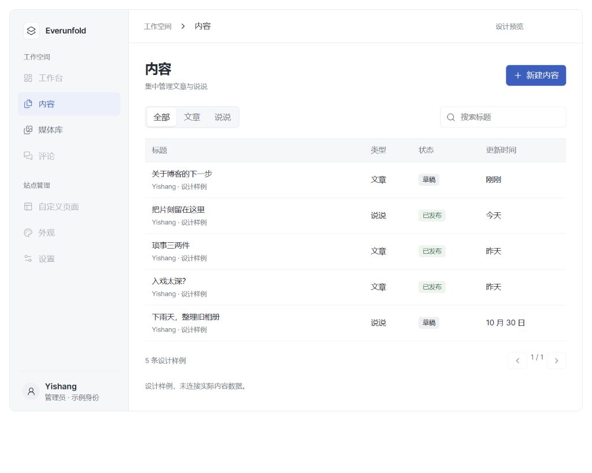

# 后台界面参考调研

版本：admin-research-1。调研日期：2026-11-01（Asia/Shanghai）。范围为公开官方文档、官方组件示例及文档截图；未登录第三方管理系统，不把这些样例当作其全部产品或最新线上界面的保证。

## 需求与结论

用户明确希望后台简洁、专业，不必追求前台主题视觉一致；后台展示仍由前端主题管理，架构保持清晰。建议采用“浅色侧栏 + 内容工作区”：参考 shadcn/ui 的中性层次、Supabase 的克制原则、Directus 的内容工作流，保留 WordPress 熟悉的内容分类方式。参考设计不等于安装同名 UI 框架。

## 官方参考与取舍

| 参考 | 查阅到的特征 | Everunfold 建议采用 | 不直接照搬的部分 |
| --- | --- | --- | --- |
| [shadcn/ui Blocks](https://ui.shadcn.com/blocks?category=dashboard) | 官方 dashboard-01 将侧栏、页头、统计、图表和表格分别组合；官方浅色截图以中性背景和细边框组织界面 | 独立后台壳、统一页头、轻量分隔、可复用列表组件 | 示例营收、增长卡和图表不是博客需求；不整页复制示例 |
| [Supabase 设计原则](https://supabase.com/blog/how-design-works-at-supabase) | 2023-12-08 的官方文章强调去除冗余、降低视觉强度、克制品牌色和复用交互模式 | 主操作才用强调色，状态与操作位置稳定，优先任务效率 | 面向 Postgres 开发者的 SQL/多组织复杂度不适合直接搬入单站博客 |
| [Directus Layouts](https://directus.com/docs/guides/content/layouts) | 默认内容列表为表格，可调整行距、列、排序；文件库默认卡片布局，支持图片适配与无图回退 | 文章/说说共用列表；媒体采用网格与详情；按任务选择展示模式 | 地图、日历、看板和多层配置面板暂不需要 |
| [Ant Design Layout](https://ant.design/components/layout-cn/) | 导航强调当前位置，侧栏可折叠并响应视口；布局由 Header/Sider/Content 等职责组成 | 明确导航层级、页标题/操作区域、窄屏收纳与一致的表单/详情位置 | 不引入其整个应用模板、路由框架或多标签工作台 |
| [WordPress Administration Screens](https://wordpress.org/documentation/article/administration-screens/) | 管理界面分为工具栏、主导航、工作区等区域，按文章、媒体、页面、评论、外观、设置组织 | 保留熟悉的内容管理入口与“访问站点”路径 | 不复制深色窄侧栏、老式密集链接和插件堆叠的菜单 |

以上是官方资料观察；下面的尺寸、配色和目录是本项目建议，不是外部产品的规范，也不是用户已验收的成品。

## 推荐视觉方向

- 中性浅灰工作背景、白色内容表面，依靠留白、对齐和细线建立层次。深色版本保持同样结构。
- 建议以低饱和蓝作为后台默认强调色；也可换成主题提供的其他克制色值。色值统一定义在后台主题 token，页面不硬编码。
- 导航、按钮、表单、提示和表格状态一致；保留清晰键盘焦点。前台的星空、玻璃层、长入场和惯性滚动不作为后台默认体验。
- 优先展示工作内容。工作台将来可放继续编辑、待处理评论与最近活动；在真实接口完成前保持空态，不用随机数字或装饰统计填满。
- 桌面推荐侧栏 224px、顶栏 56px、内容边距 24–32px，正文 14px、标题 22–24px、圆角 6–8px；列表单行 48px、双行 60–64px。移动输入字号至少 16px、可点击目标约 44px。均为待实际页面验证的初值。

## 页面样式方向

1. 内容列表：标题与主操作同一行；下方搜索/类型/发布状态筛选；表格以标题为主、状态为辅；选择条目后才出现批量操作。类型与状态分开，访问策略另列或放详情。
2. 编辑：进入独立页面，正文为主，右侧属性可收起；长文编辑不压进弹窗。保存状态区分本地修改、保存中、服务器已确认、失败/冲突。
3. 媒体库：网格优先，必要时切列表；选择文件看元信息、引用和交付状态。虚拟目录/标签不等于磁盘目录；缩略图来源以后端媒体契约为准。
4. 评论：列表 + 原文上下文，审核/回复操作位置固定；真实失败保留编辑内容，删除显示可恢复范围。
5. 设置：按站点、阅读展示、媒体、账号/权限、系统分组；表单使用统一字段行、帮助与错误，不把所有选项塞进同一页。

## 预览与限制

本轮会话提供内容列表/媒体库的可交互设计预览（示例身份、标题、状态和文件，不接入 API）。它只用于比较布局、筛选与信息密度，不能复制为生产页面。正式实现必须使用现有项目封装控件及后端生成契约；示例数据不得进入真实后台。

桌面预览留档（全部为设计样例，不代表后台业务已实现）：

目录、主题边界、偏好与验收顺序见 [后台设计规范](../architecture/admin-ui.md)。此研究不决定新增依赖，也不承诺其他产品当前版本的兼容性。
