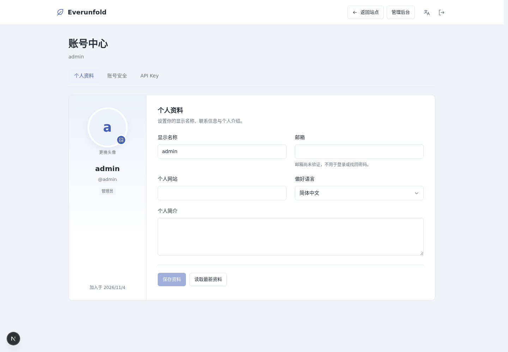
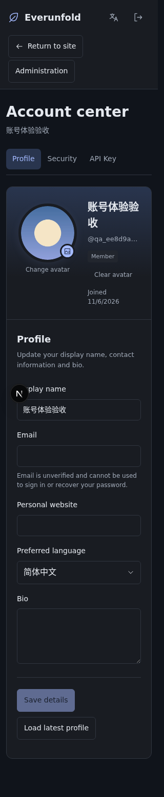
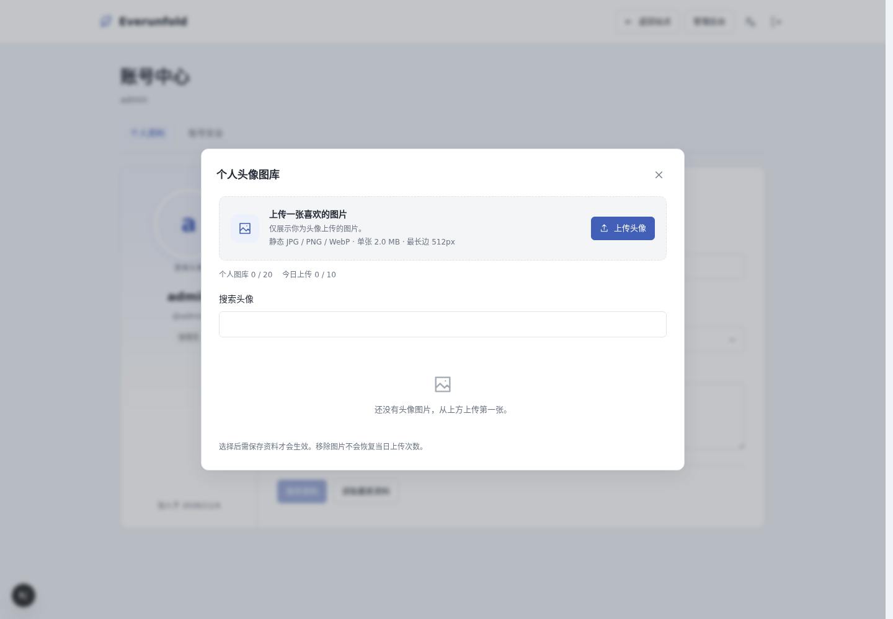
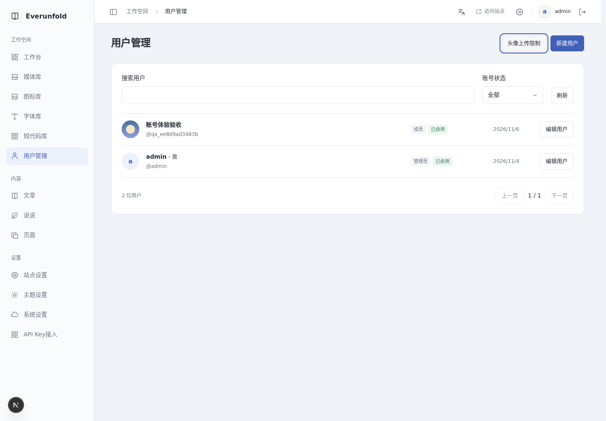
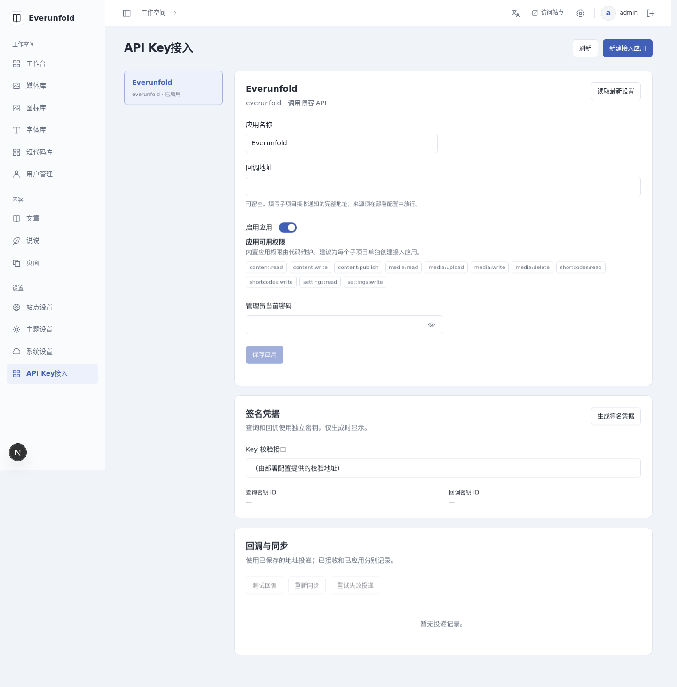

# 账号、头像与API Key验收

日期：2026-11-06（Asia/Shanghai）。对应[ADR0069](../decisions/0069-accounts-api-keys-and-signed-callbacks.md)、[账号指南](../development/accounts.md)与[应用协议](../development/api-key-applications.md)。只记录本次执行结果，不把未运行的浏览器或容量矩阵当作通过。

## 实现与自动检查

0019、0020、0021已显式应用到本容器业务库和隔离测试库。accounts1.3.0、auth0.2.0、content-admin1.9.0、api-key-protocol1.0.0已发布；前端分别从后端8ecfcfd、f14c6be、36f7fc0的已提交契约生成并保留SHA。未新增运行时依赖。

| 检查 | 本次结果 |
| --- | --- |
| 后端真实数据库全套 | 210项通过，171.35秒，含业务回归及独立进程P0 |
| 后端最终静态检查 | Ruff、390文件格式、mypy 197源文件通过 |
| 最后账号/协议局部复核 | 13项通过，含最终敏感字段及Node缓存边界 |
| 前端`npm run check` | 254项通过，ESLint/Next类型/TypeScript/Prettier/错误页产物通过 |
| 隔离生产`verify:admin` | 构建通过，26私有入口200、匿名SSR壳、no-store/noindex、资源及无后端入口通过 |
| 公开回归 | 代码/公式按需资源，多语言/第三语言回退，离线阅读200、撤回404，冷/损坏设置503通过 |

真实权限P0使用两API、PG/Redis、两个Worker、自研Scheduler与独立Node子项目。覆盖用户/Key/应用权限交集、坏Bearer不降级Cookie、本人查询/操作、无发布权、最后管理员竞争、密码重置与旧密码登录竞争、Session和已建立协作WS撤销。头像覆盖本人隔离、跨人设置拒绝、无完整媒体权限、格式/大小/元数据/缩图、稳定ID重试、最后名额并发和每日配额。

独立Node验证读缓存不滑动、写入每次查询、撤销Key拒绝、签名方向/目标绑定、防重放、签名ACK、失败重试、重复/乱序回调及迟到响应不回填；另以110秒时钟差和延迟响应验证截止时间不会被本机时钟延长，调用者修改返回对象不能篡改缓存。

## 实际浏览器

连接的浏览器工具要求重新认证，无法执行；按用户已授权的容器浏览器方案，使用本地Playwright与Chromium检查实际HTTP服务。管理员与独立普通用户上下文隔离，1440px及320px均检查；页面运行时异常累计0。

- 账号中心：资料左右分区、独立头像上传/选择/保存、刷新后保持；未保存离页确认，取消保留输入。安全页完成首次改密、密码显示切换及会话读取。
- 头像库：普通用户只见本人图片，900×600源图生成最长边512px的WebP；选择后保存资料才应用。完整媒体上传/目录拒绝且菜单隐藏。弹窗进退、Escape返回触发器、单内容区滚动与窄屏无横向溢出通过。
- 用户管理：搜索、限制读取、新建临时用户、启停、授权及重置密码完成。本人编辑/全部读取授权时，外人内容列表进入预览，直接编辑URL显示只读，不启动可写协作。
- 应用/Key：页面创建专用应用与显式只读Key，独立Node真实签名查询成功；页面撤销后写查询立即inactive、Bearer业务401。新应用编辑器重挂载不丢失首次凭据展示，查询/回调密钥独立。
- 中文/英文、深色/减少动态：显示名和正文不因界面切换翻译；头像上传/关闭与资料按钮有英文。账号中心和头像库在320px无横向溢出，Escape焦点正确。顶栏语言图标不加国旗，原前台顺序保持。

## 发现与修正

第一次后端209项中，旧WordPress预览撤回CLI因容器数据库服务名触发loopback限制；进程测试增加临时loopback转发，产品守卫保持。后续OpenAPI覆盖发现头像路由缺少统一错误模型声明，补齐后最终210项通过。

新应用创建后编辑器重挂载会清空首次凭据，已将展示状态提升到父组件；轮换结果等待确认窗退出再出现，避免双模态抢焦点。窄屏应用面包屑、英文账号头部溢出已修复；未修改的旧头像在编辑其他资料时保留。

一次格式检查在补加导入后失败，按Prettier整理后最终全套通过。深色首图捕获了主题过渡中间帧，稳定后重新检查并截图。验收清理首次使用裸媒体UUID被正常422拒绝，改为既有`media:`引用后可恢复回收成功，不是产品接口失败。

## 数据与限制

本次两个普通账号、已撤销Key及专用应用按精确ID/用户名和引用检查清理，保留认证审计。头像先清除选中/移除本人引用，再经统一媒体接口进入可恢复回收站；未物理删除共享原件。原有管理员、文章/说说、站点/主题设置与WordPress未更改。设备地址、临时密码、Key与签名密钥不进入文档或截图。

当前六服务继续使用原HTTP部署和`0.0.0.0`，API/Worker读取同一稳定签名主密钥，回调来源由部署放行。凭据只在生成时显示，回执和任务不保存明文。

未做长期负载、全部浏览器/实机、完整网络分区矩阵或生产容量承诺。未提供公开注册/邀请、邮箱验证/找回、2FA。普通读取撤销依赖可靠回调和最多30秒短租约，不承诺网络分区零延迟；已执行业务不回滚。Node参考是单服务进程，多实例须共享失效下界/缓存或关闭读缓存。

## 自建截图

仅含独立验收数据，不截图凭据，应用查询地址已遮盖。

