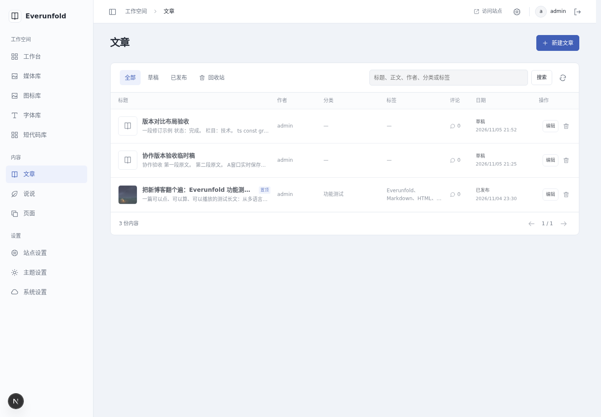
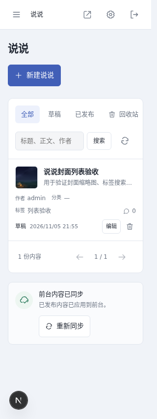
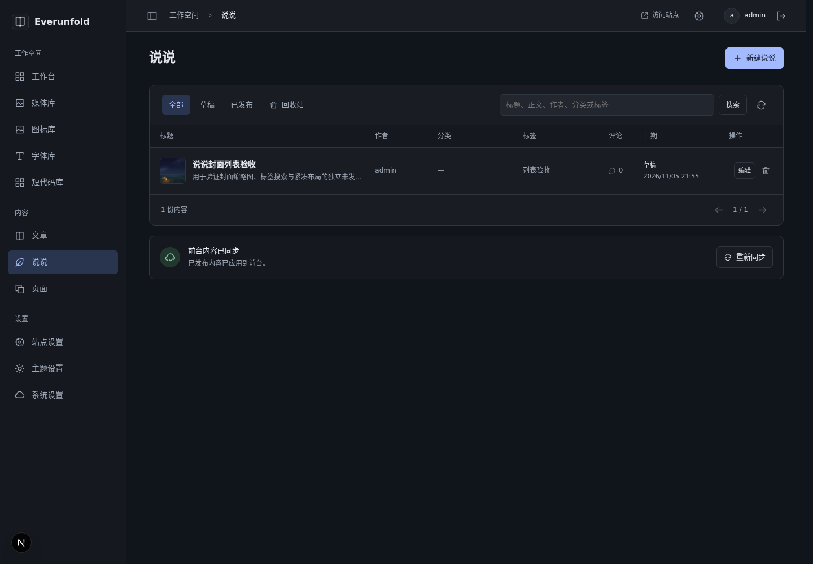
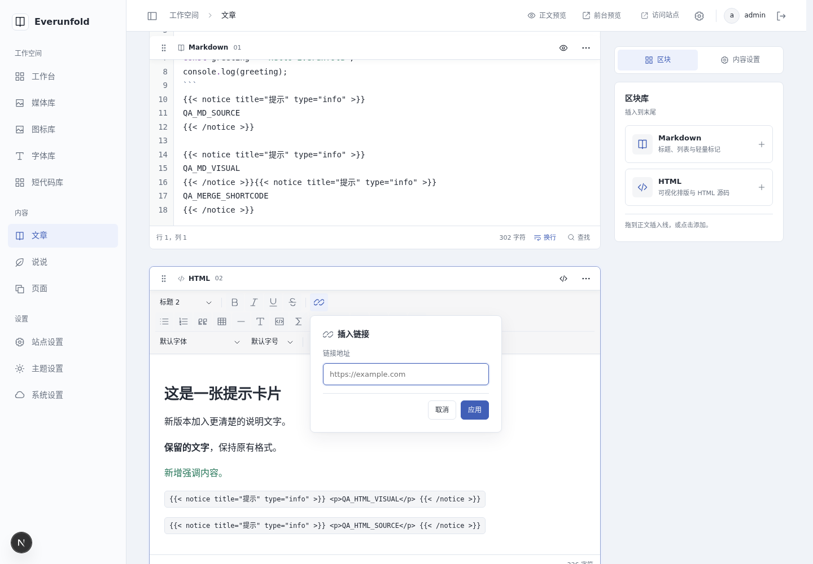
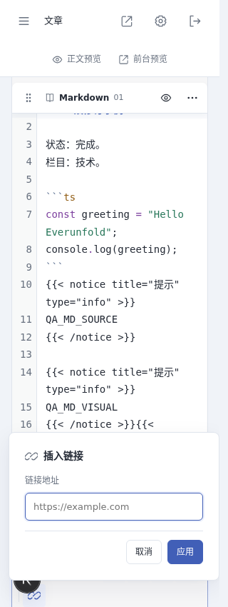

# 紧凑内容列表与编辑工具验收

日期：2026-11-05（Asia/Shanghai）。对应[ADR0063](../decisions/0063-compact-content-lists-and-editor-tools.md)。后端代码d42cb8b，前端编辑工具13dd0a3、列表d760998；仅本地提交，由用户推送。

## 自动检查

- 后端真实专用测试环境完整185项通过，69.28秒；包含现有多进程、数据库、协同、发布与媒体守卫。扩展既有编辑属性真实用例，核对按标题/作者/分类/标签查询后的封面URL、分类、标签、置顶、评论数、类型隔离，且列表不暴露正文数组或访问密码。
- 后端Ruff、格式163文件、mypy160文件通过；没有依赖或数据库迁移变化。content-admin1.6.0及OpenAPI重新导出，前端从已提交的d42cb8b生成；DraftDetail和collaboration契约保持。
- 前端最终完整npm run check的238项、ESLint、类型生成/TypeScript和格式检查通过。
- 最终npm run verify:admin的隔离生产构建和21个私有入口通过：no-store/noindex、匿名SSR无正文、按需代码/公式资源、离线公开读取/撤回、设置缺失与最新损坏拒绝回退。构建使用临时副本，没有覆盖运行中的Next开发产物。
- 工作区启动脚本--check通过：六个进程运行，四端口0.0.0.0，API、代理健康和后台页面HTTP200。继续使用HTTP，实际设备地址及密码不写入交接。

## 浏览器实测

使用用户已允许的独立容器Chromium、新测试上下文与正常登录，不接管用户日常浏览器。仅修改独立未发布验收稿；原公开功能长文及WordPress备份未改。

- 文章桌面七列显示真实作者、分类、标签、已审核评论数和状态/日期；功能长文的可用封面替代图标，未提供封面仍显示类型图标。当前三行均为82px，标题保留一行摘要，置顶标记不再挤出额外一行。
- 独立创建“说说封面列表验收”，通过媒体选择器设置封面与标签；列表44px内图加载成功（外框46px），按标签检索可命中。实际回收/恢复后封面仍可见；验收结束再次回收，未发布且可恢复。
- Enter/搜索按钮提交，作者admin、分类、标签关键词、无结果、清除和重复点击当前状态可正常使用。分类查询另由后端真实用例核对。模拟查询503，保留已有行并出现重试；解除故障后恢复成功。
- 模拟封面网络失败，回退为类型图标；恢复网络并刷新后重新显示封面，不留破图。空列表继续提供原空状态，单条列表不再强制保留250px正文空白。
- 1440/1100/768/320px列表检查无横向溢出；窄屏保留封面、字段标签与操作，系统深色、减少动态下状态和文字可见。主要桌面82px是当前数据实测值，不限制长标题或窄屏内容自然增高。
- 链接弹层验证空地址占位、新增链接、读取当前地址、移除链接、非法协议错误、取消/Escape与焦点回到触发器。320px弹层x=12、宽296，系统深色和减少动态显示正常；没有横向越界。
- Markdown/HTML源码及可视化四种入口均显示“短代码”文字按钮；按当前光标插入notice原生调用，两块的稳定ID与块数量保持。工具图标实际18px，按钮可换行。
- 用本机恢复分支验证合并结果新入口：插入后服务器保存，暂停时两个短代码入口均禁用，恢复后内容仍在，真实完成合并并解锁。另开无IndexedDB的新上下文读取服务端最新版，四种模式插入内容及合并结果调用均保留。没有发布验收稿，最终无浏览器pageerror。

## 截图

## 限制

没有新增列排序/列偏好、批量操作、分类标签独立筛选或全文检索索引；未进行大量条目分页压力、跨浏览器/读屏器完整矩阵。评论列沿现有业务统计已审核数量，不包含待审数量。未重复上一阶段完整中文输入与掉线合并浏览器故障矩阵，本轮真实后端完整回归和合并工具实测不替代长期稳定性测试。两仓库同步ADR、指南、验收、截图和哈希，STATUS分别维护。
