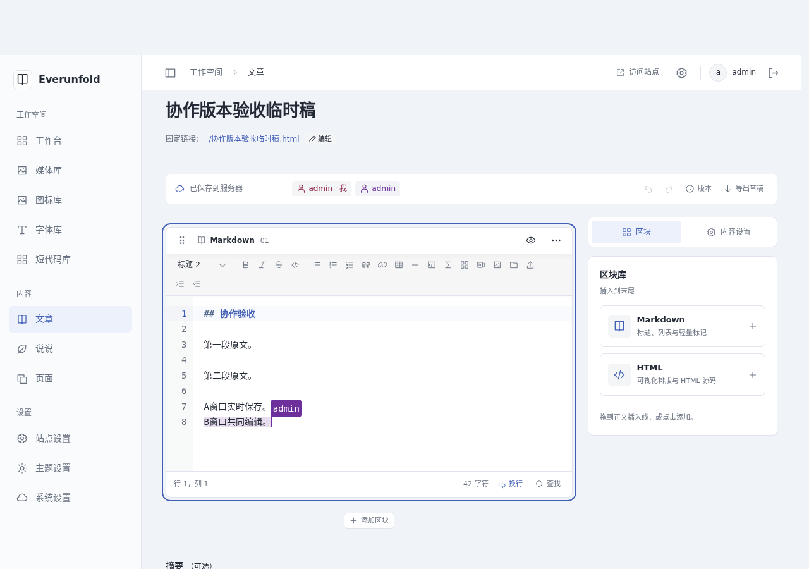
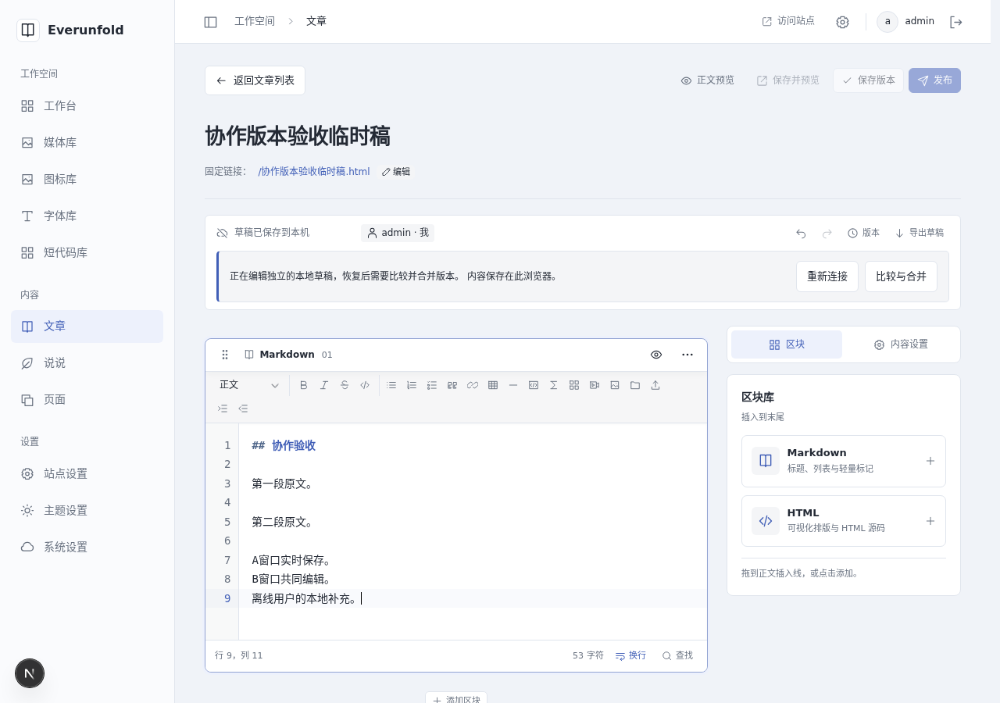
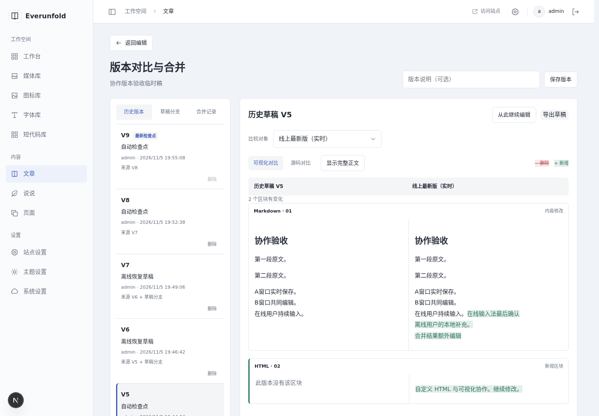
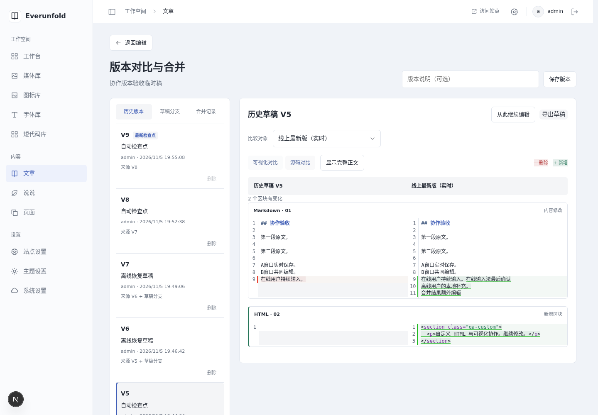
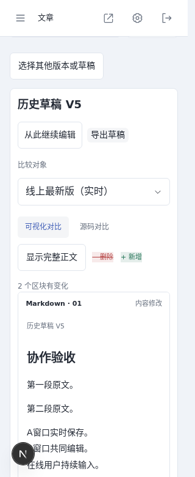
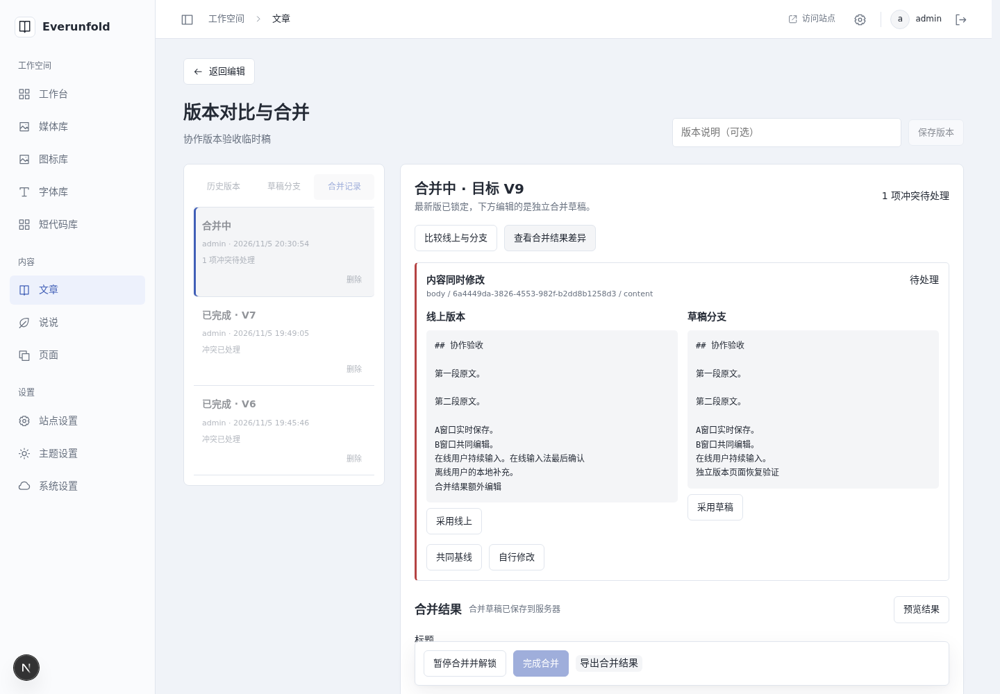

# 光标、离线恢复与独立版本页验收

日期：2026-11-05（Asia/Shanghai）。范围：[ADR0061](../decisions/0061-cursors-offline-branches-and-version-merges.md)；使用见[版本指南](../development/draft-versions.md)。本记录不含设备IP、凭据或WordPress备份数据。

## 代码、数据库与检查

- 后端0017显式迁移已应用于实际容器库和隔离测试库，服务启动不执行迁移。检查点、历史软删除、分支、持久合并租约及旧epoch基线已落地。
- 后端完整真实环境回归185项通过（70.51秒），Ruff检查/格式通过，配置内mypy160文件通过。两真实API/PostgreSQL/Redis用例包含在线更新与合并开始竞争、丢ACK回执核对、迟到更新、所有写入口锁、取消/超时、完成幂等、PG故障回滚、历史删除、旧epoch拒绝。
- 扩展P0验证合并换代后保留已移除块原文、强制人工源文复核、无效结果422、合并结果独立持久化，以及派生分支保留经核对的共同基线。
- 前端完整check236项、lint/类型/格式通过；包含真实CodeMirror状态绑定的CRLF/emoji/并发插入/相对光标/本人撤销、晚到中文输入/换epoch分支恢复、旧队列导入、复制标签身份、区块删除源文保留、差异渲染转义和暂停恢复决策与迟到租约应答保护。
- 隔离verify:admin通过生产构建、21个私有入口（含文章/说说versions）、no-store/noindex与匿名SSR隔离，并验证混合正文按需资源、离线公开阅读、撤回与设置快照故障行为。没有用构建代替真实协同检查。

## 实际浏览器

原本应用浏览器控制被Work设置禁用。用户随后授权安装/使用容器浏览器，使用项目已有Playwright运行独立、全新Chromium Headless Shell143.0.7499.4上下文，不读取用户原浏览器资料。浏览器通过实际HTTP入口、正常UI登录，以独立未发布的“协作版本验收临时稿”验收；原功能长文未保存或发布。

- 双窗口输入实时到达，刷新仍存在；源码选区与HTML可视化选区显示对应文字，成员点击定位有效。本人标签DOM与位置在输入/成员变化中保持，未重置表单或跳动。
- B窗口真实网络断开，提示暂停，选择继续本地编辑后仅本机保存；A继续线上编辑。B恢复并刷新仍保留分支，明确开始比较/合并。
- A通过浏览器输入法协议开始中文composition，B开始合并。A最后确认输入保留为恢复草稿，最新版只读。人工合并、结果补充、自动保存、完成及双方收敛通过。
- HTML视觉修改实时到达另一窗口；自定义section/class/缩进原文保留。撤销新增块后，另一人写入仍存在于removed_blocks导出中。复制打开的页面获得不同客户端身份。
- 当前最新检查点删除禁用；旧历史经共享确认窗口移除。版本入口实际进入独立路由，无版本弹窗。刷新选中历史/活动合并可恢复；可视化文字增删、区块新增及源码变化真实可见。
- 1440px与320px检查无页面横向溢出；目录在窄屏可展开选择并自动收起，源码两份上下展示，版本页没有额外纵向滚动容器。早先弹窗的双滚动修复已被独立页替代。
- 从历史继续编辑保留独立本机草稿，再进入版本页可比较并提交。活动合并刷新、结果差异切换、取消离开、暂停保存解锁并返回编辑均通过。
- 暂停恢复额外核对未决原冲突仍阻止完成；相同目标恢复显式决策/结果，目标变化重新比较原分支并保留旧结果供查阅。最终独立页完成合并后另一窗口读到结果。

## 自建截图

## 过程修正与限制

测试发现的错误均先修正：版本路由需注册才能越过公开路由解析；真实契约检查要求补全500错误声明；初始区块必须与可撤销插入分离才能保留他人文字；暂停恢复不能用临时默认结果替代未决原分支冲突；延迟续租响应只更新到期时间，不能回退已处理决策或完成状态。最终检查以修正后结果为准。

本轮覆盖单容器Chromium及真实双API，多进程P0在隔离数据库中执行；未完成跨浏览器/读屏器/长期断网/容量压力矩阵、浏览器崩溃或磁盘耗尽注入。富文本只支持块内选区，不承诺任意跨块选择；投影重叠会进入人工分支。跨刷新撤销、物理GC/压缩、细粒度ACL、离线冷启动和自动无人审查合并均未交付。清理本机浏览器数据会删除尚未上传的草稿。

API/前端/代理/接收器/worker/scheduler保持运行，worker和scheduler已载入新代码。工作区脚本--check核对六服务、四个0.0.0.0端口和HTTP200通过；容器未整体重启，未声称冷启动演练。源备份未改，实际地址仍只在忽略配置中维护。仅本地提交，由用户推送。
