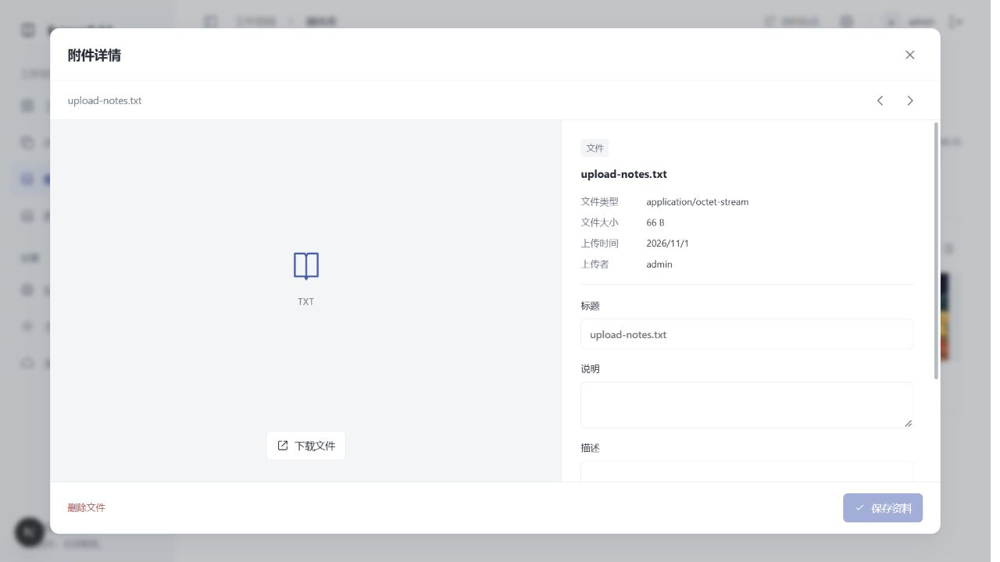
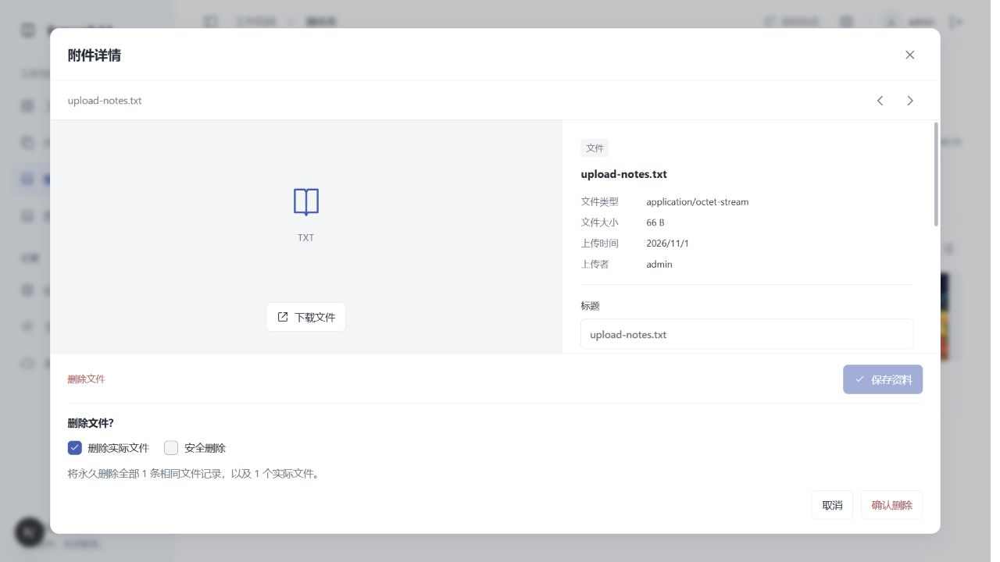
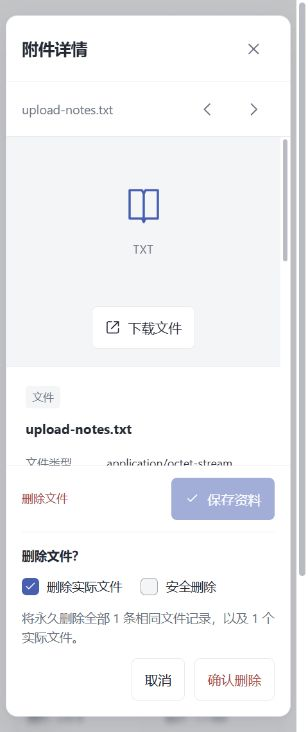
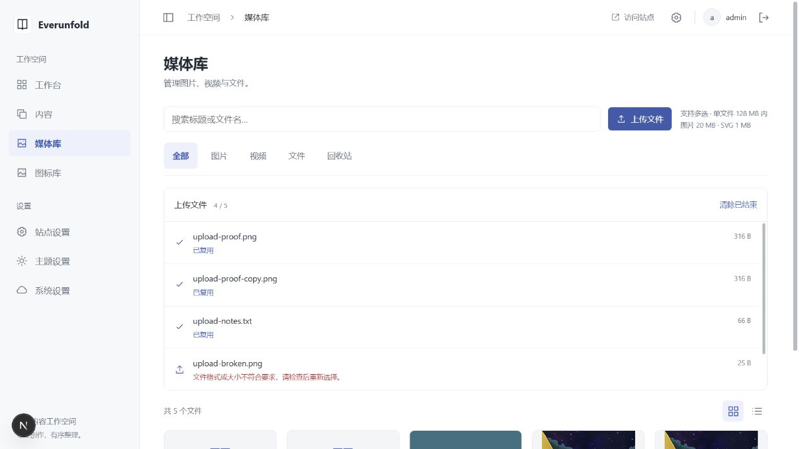
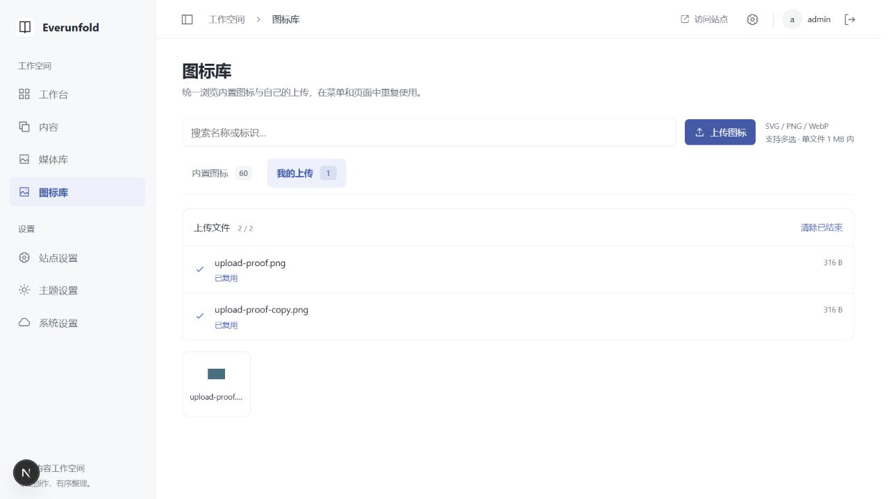

# 多文件上传与安全删除验收

日期：2026-11-01；Windows 本机，独立 FastAPI/PostgreSQL/Redis/Celery/Scheduler 与 Next.js。决定见 [ADR 0027](../decisions/0027-shared-upload-queue-and-safe-removal.md)，操作见 [媒体指南](../development/media-library.md)。

## 实现版本

- 后端上传基础 e07d877、安全/整组删除 c550a64、响应契约修正 a543d7e；显式迁移到 0008_media_safe_delete。
- settings 1.6.0，前端锁定 a543d7e 的权威契约；upload_id 与 operation_id 分别固定上传和删除请求身份。
- 不新增依赖。Next.js 3000 持续运行；API 8001 已更新。原 WordPress、原素材、用户账号/设置不修改；两条既有同名媒体记录保留，不自动合并历史重复。

## 后端实际检查

`uv run --locked ruff check .`、`ruff format --check .`、`mypy`（97 源文件）通过。`RUN_DATABASE_TESTS=1 uv run --locked pytest -q`：**104 passed，72.71 秒**。完整夹具包含真实双 API、PostgreSQL、Redis、Celery Worker、独立 Scheduler 和前端设置接收器，不以进程内 mock 替代并发/事务验证。

新增断言覆盖：

- 两 API 同时上传相同字节、不同请求 ID，只产生一个可用内容身份；旧请求重试结果稳定；改字节复用旧 ID 冲突；元数据保持，合格资源可复用为图标。
- HTML 下载附件而非执行、空文本文件、ZIP、大小/类型校验、CSRF；未知结果不会假称成功。
- 默认回收、原 URL 不可读、查询回收站、恢复；原件删除后旧上传回执不复活资源。
- 同哈希旧记录模拟为两个不同 object_key：安全删除仅移除一个记录并保留两份文件；最后记录清理全部留存路径；回收站条目仍计入保留判断。
- 关闭安全删除整组移除；审计失败导致全部 DB 改动回滚，文件未动；任一组成员被当前/历史引用时拒绝整组删除。
- 两 API 同时安全删除，只有一个按当前范围成功，另一请求范围冲突，重新确认后正确清理最后一条。
- 预览后新记录加入产生 40939；完成后的旧删除回执重试不捕获新上传记录。
- 文件字节异常导致可重试 pending，不继续公开；修复存储后复用同一操作完成，未确认物理清理时不能恢复。

中途检查发现迁移健康版本常量仍为 0007，已修为 0008 后重新运行全量通过；浏览器发现新删除响应未使用契约外壳，已修复并增加前端生成客户端回归。早期导入路径/格式问题均已修复。未执行真实 CDN、云端对象删除、跨平台文件系统、容量压力和浏览器进程中途崩溃恢复验证。

## 前端实际检查

`npm run check`：生成产物一致、ESLint、严格类型、格式和 **117 项测试**全部通过。新增测试覆盖 XHR 的真实字节进度/CSRF/Cookie、未知总长度、不支持进度时单次 fetch、不暗中重发已发送失败、取消、并发 2、单文件错误隔离、稳定重试 ID、服务器确认前的保存状态及删除响应外壳。

`npm run verify:admin`：隔离生产构建通过；登录和所有后台路由 private/no-store/noindex，后端不可达且无公开缓存时后台入口仍可打开。公开冷缓存 503、合法本地快照与设置可用 200、损坏最新快照 503 均按既有规则通过。不删除或重建正在运行的 3000 开发服务目录。

## 浏览器实际操作

- 媒体库一次选择 5 个自建文件：两张相同 PNG、文本、无效 PNG、24 MiB ZIP。两个并发上传，余项排队；4 项成功（其中重复内容复用），无效 PNG 独立失败。重复整批上传显示已复用，文件总数没有增长。
- 图标库一次选择两张相同 PNG，启用多选，共用进度队列，两项都复用已存在媒体，「我的上传」只出现一个图标。
- 通用文件详情显示下载入口、名称/大小/类型和可编辑资料；删除与保存按钮纵向中心对齐，删除靠左、保存靠右。
- 展开删除确认，切换实际文件/安全删除，后端范围文本随选择更新；桌面、390px、320px 下选项/取消/确认可达，窄屏文档无横向溢出。浏览器未点击最终破坏性确认，实际删除通过隔离 API 测试验证。
- 自建文件完成浏览器验证后，经本机 API 再核对名称、SHA-256、单记录/单文件范围后清理；未清理用户资源。预览回到正常媒体库，视口恢复。

进度能力不足的回退由可控 XHR/fetch 测试覆盖；未声称已在所有浏览器品牌中实测。

## 截图

## 接续边界

新附件/编辑器上传入口复用现有传输、队列与主题组件。完整结构化引用图/未来协同草稿、跨页面持久队列、断点分片、普通文件在线预览、远端上传/条件删除、CDN purge 和 WordPress 整体媒体迁移未交付。新增引用来源必须加入守卫再开启永久清理；不能把本机物理删除描述成全网缓存撤回。
