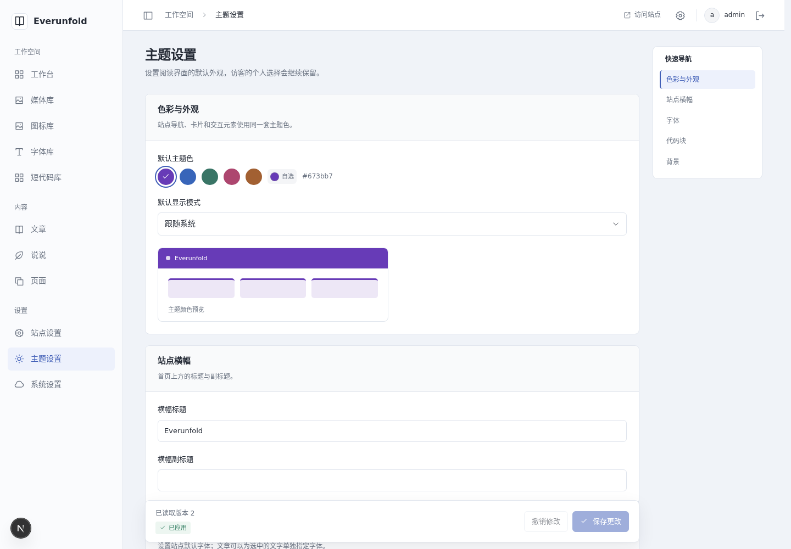
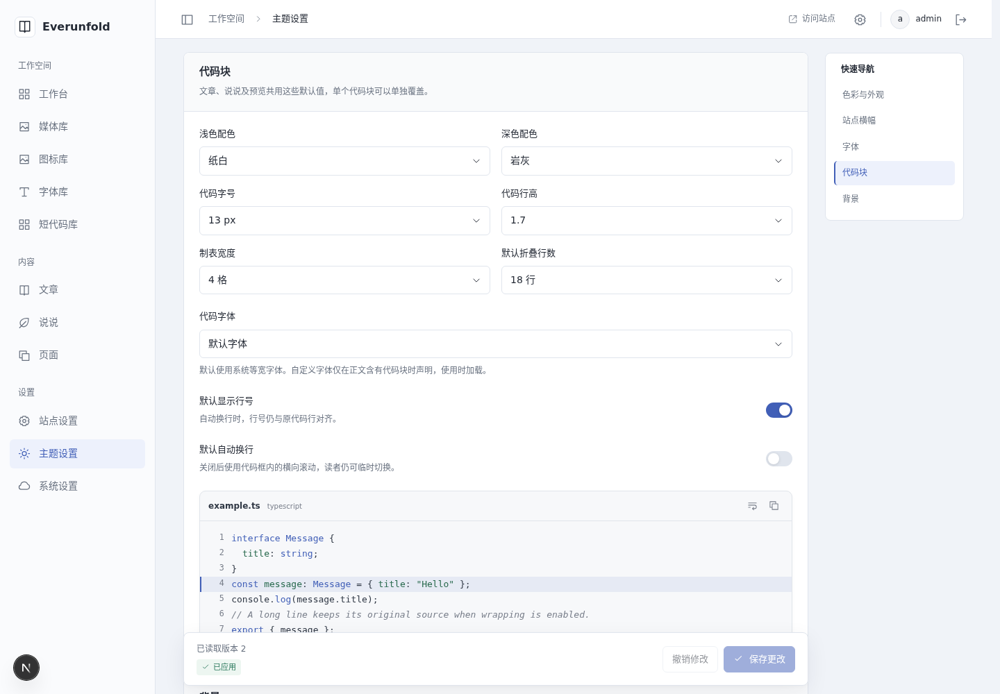
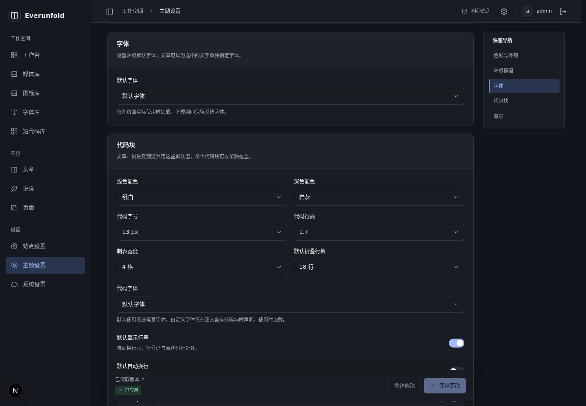
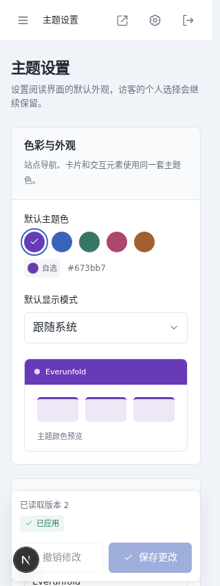

# 桌面设置页分区导航验收

日期：2026-11-05（Asia/Shanghai）。对应[ADR0064](../decisions/0064-desktop-settings-section-navigation.md)。本轮仅增加前端展示与锚点定位，没有业务接口或数据库变化。

## 检查

- 最终npm run check的238项、ESLint、类型生成/TypeScript和格式检查通过。没有为低风险展示变化增加复述实现的单元测试，位置、焦点、输入保留使用真实页面验证。
- 最终隔离npm run verify:admin通过：生产构建、21个后台私有入口及无正文SSR泄漏、按需资源、离线公开读取/撤回及设置快照故障检查。未覆盖运行中的Next开发产物。
- 本阶段未重复后端185项；本轮此前的列表API变更已完整通过185项真实回归，详见[列表与编辑工具验收](content-list-tools-verification.md)。本阶段后端只同步文档。

## 页面与交互

Browser Use连接返回需要重新认证；沿用户已允许的容器独立Chromium继续测试，没有要求用户中断工作或接管日常浏览器。

- 1440px三个页面的目录分别为3/5/3项，包含主题“代码块”；内容和保存栏位于左列，右侧目录滚动后固定在y=76px。
- 主题页逐项点击后高亮与目标一致，非页底目标top约80px、顶栏bottom56px；首次发现全局72px与分区滚动留白叠加，已修正。异步加载后刷新#settings-code仍定位到代码设置并高亮。
- 系统页短分区靠近底部时，点击“站点与主题发布”与“部署配置”分别选中本项，不误标下一项；没有保存节点策略或重新同步。
- 键盘聚焦“字体”链接并Enter后，焦点落在settings-fonts；从代码块执行浏览器返回恢复#settings-fonts及对应高亮。手动滚回顶部高亮色彩与外观；离开设置页后目录不残留在文章列表。
- 修改横幅副标题但不保存，跳到代码块后输入仍在、保存按钮可用；使用原撤销按钮恢复，重新读取确认输入和版本保持、保存按钮禁用。未向后端保存设置。
- 1200px显示、1199/768/320px隐藏目录，页面无横向溢出；320px表单/保存栏沿既有布局。系统深色和减少动态下目标、目录高亮与焦点清楚，测试后恢复浅色及正常动态。
- 最终无浏览器pageerror。六服务继续运行，HTTP与0.0.0.0保持，未改正文、发布内容或WordPress；实际设备地址不进入交接或截图。

## 自建截图

## 范围

仅覆盖当前三个设置页和现有分区，未进行长目录压力、读屏器或跨浏览器全矩阵。没有设置全文搜索、窄屏跳转菜单或逐字段导航；本轮未用真实保存验证既有设置投递业务。两仓库同步ADR/指南/验收/截图与哈希，STATUS各自维护，仅本地提交，由用户推送。
