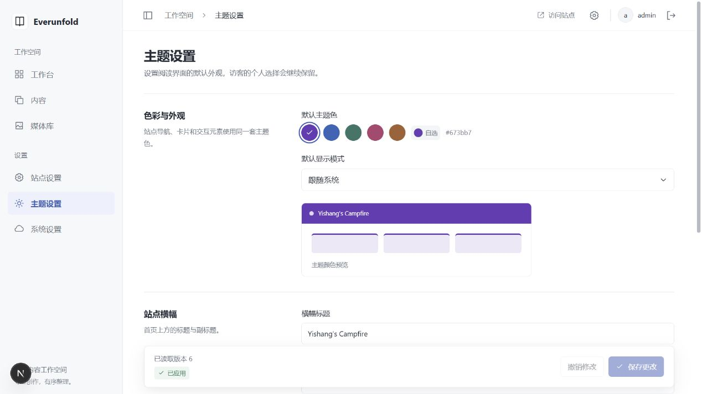

# 基本设置：实际验证记录

日期：2026-11-01。范围：settings-1 / 数据库修订 0004_settings / settings-runtime-1。依据 [ADR 0024](../decisions/0024-versioned-settings-delivery.md)。未宣称完整 CMS、内容可靠发布、媒体上传或通用插件加载器已经完成。

## 后端

- Ruff 检查、格式检查通过；mypy 75 个源文件通过；启用真实数据库的完整 pytest **68 项通过**。新增跨文件测试辅助模块使用明确的 tests 包，避免 mypy 同一文件被不同模块名导入；全新子进程验证 Scheduler 仅导入队列配置，不加载业务投递或 API 模块。
- 真实设置用例创建独立 PostgreSQL 临时库并显式初始化；两个 Uvicorn API、Redis、独立 Celery Worker、独立 Scheduler 和 Node 接收器同时运行。
- 未登录 401、缺少 CSRF/错误 Origin 403；两 API 以相同 revision 竞争保存，恰好一个 200、一个 409。
- 故意让审计约束拒绝写入：业务版本、设置值和投递事件一起回滚，没有部分成功。
- 接收器离线：设置仍保存在 PostgreSQL，显示待重试；上线后最终收到配置。
- 接收器已完成落盘但确认被延迟时终止 Worker/接收器；重启并等租约回收后，同一版本安全重投并确认，只有一个完整版本文件。
- 策略独立保存后，接收器文件值与响应一致；测试接收过的文件随后丢失，重新同步重建当前版本，不额外增加业务 revision。
- Node 单元测试验证实际 socket IP AND token（伪造转发头不能通过）、来源 epoch、版本字段、并发/乱序、同版本冲突、部分文件不可见、重启读取与最新文件损坏失败关闭。

## 前端与生产 HTTP

- `npm run check` 完成错误页产物一致性、ESLint、严格类型、格式与 **100 项测试**。
- `npm run verify:admin` 在独立构建目录成功构建真实 Next 生产包；登录、原三个后台页和新增三个设置页均 200/private/no-store/noindex/匿名壳。后端固定 503，未发生 SSR 身份或公开快照回源请求。
- 后端不可用且无快照：公开页 503；写入完全合成的公开快照和 settings 副本后，同一个 Next 进程返回 200，菜单/横幅是新的已应用值。
- 文章 HTML 输出新标题模板和 noindex；最新设置副本损坏时公开页改为 503，不回退老版本，而 `/admin/settings` 仍为 200 匿名壳。
- 生成客户端校验 PATCH/POST 的正确路径、CSRF、credentials/include、no-store、revision，并确认冲突/网络失败不自动重复写；显式空导航不补回主题参考菜单。

## 本机浏览器联调

- 内置浏览器新建独立测试标签，使用已授权本地 admin 账号。在线 WordPress 标签/配置及备份未修改。
- `/admin/settings` 读取真实站点；原六个一级、七个二级菜单保留。系统页重新同步后本机 web-main 的站点/策略显示已应用。
- 临时修改首页副标题并保存：数据库版本递增、显示等待同步，随后已应用；下一次首页 SSR 可读取修改。已恢复原副标题并确认，无测试文本留在公开页面。
- 站点页未保存名称修改，切换主题页时草稿仍在，随后撤销。修复父级路径 key 导致共享设置布局重建的问题，仍保留区块动画。
- 桌面以及 390px/320px 检查：表单、手机导航和保存栏可用，document.scrollWidth 不大于视口；自定义下拉正常打开/键盘关闭，不使用浏览器原生 select 浮层。
- 页面截图见下；测试设置草稿已撤销，临时视口已还原。个人阅读偏好仍优先于站点默认值。未发现浏览器运行时 error；开发编辑期间有 Fast Refresh 全量刷新的 warning，稳定页面没有持续刷新。

## 明确限制

本机 Windows solo Worker 及 NTFS 进程重启/并发已验证，不代表生产 Linux 多 Worker 压测、Windows 断电恢复或远程对象存储行为。没有自动历史清理/容量管理/节点心跳；接收确认是最后成功记录，不是实时在线保证。最新文件损坏需处理冲突文件再重新同步；不把修复按钮描述成自动覆盖冲突。

此阶段策略控制公开动态数据，不影响正文快照 TTL、登录超时或生产派生页面缓存。完整文章发布/撤回/增量同步仍待开发。已打开前台不会强制刷新；系统策略在下一次读取页面配置后使用。通用插件注册 SDK、评论政策、媒体与高级 SEO 不在本次交付内。
