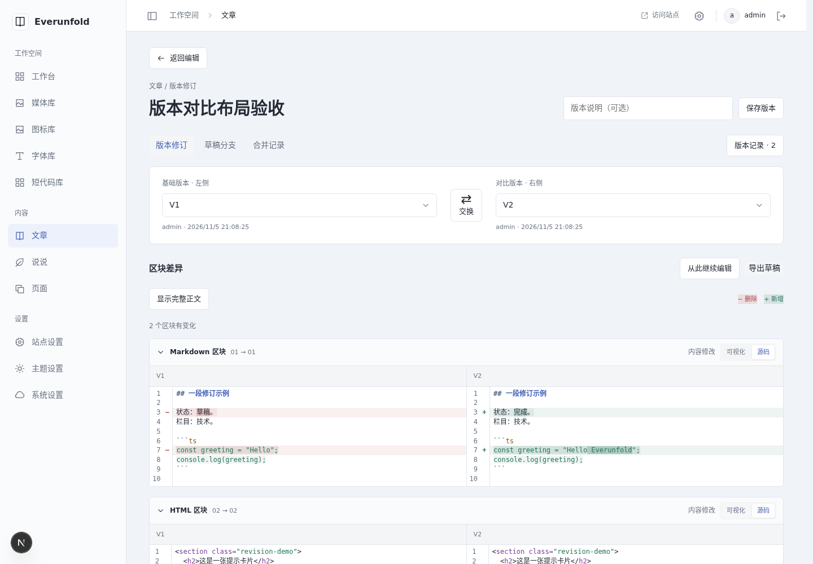
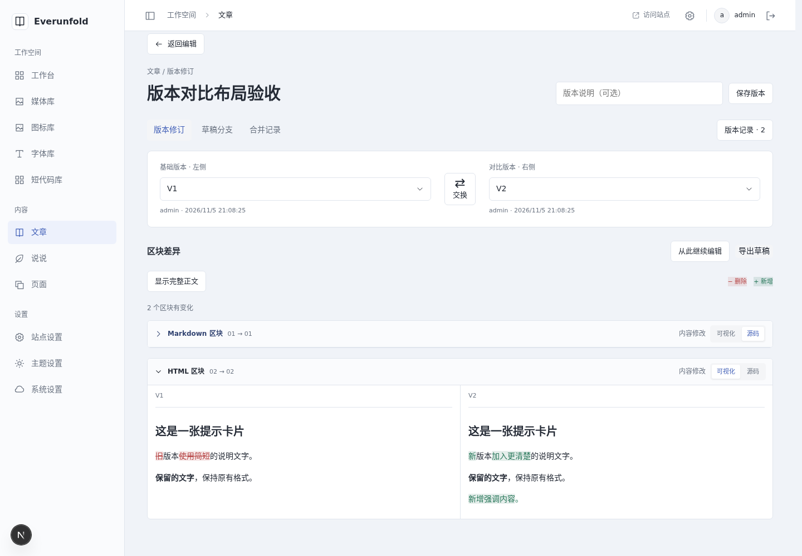
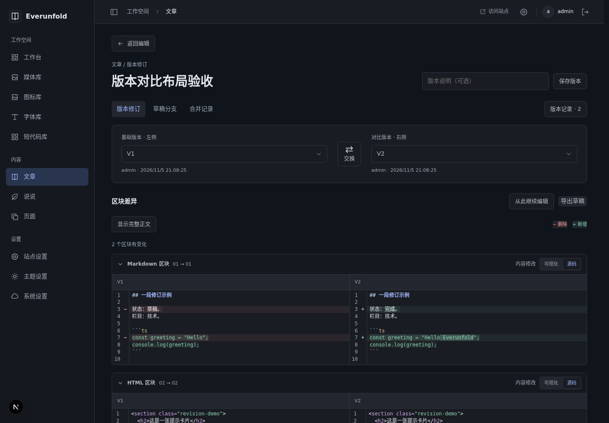
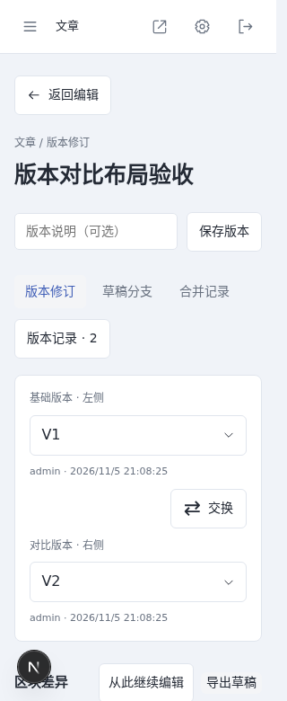
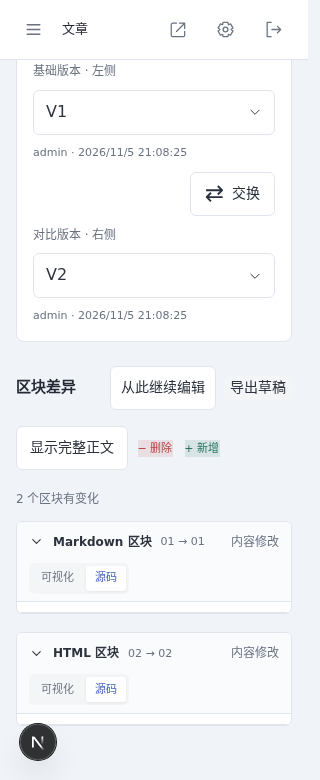
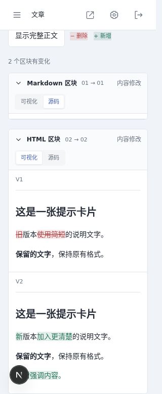

# 顶部版本选择与HTML可视化差异验收

日期：2026-11-05（Asia/Shanghai）。对应[ADR0062](../decisions/0062-revision-pairs-and-html-visual-diff.md)。本轮在独立版本页上按用户反馈调整布局和HTML默认显示，不改变协同事务或发布流程。

## 检查结果

- 前端完整 `npm run check` 238项通过，含lint、类型生成、TypeScript、格式与全部测试。
- 增加两个有实际失败依据的回归：交换使用刚更新的实时head地址而非旧渲染闭包；HTML新增段落时，未改的相同段落及结构空白不被误标。原源码/HTML转义、稳定ID配对、CRLF/emoji测试保留。
- `npm run verify:admin` 隔离生产构建与21私有入口通过，包括两种内容类型的versions、no-store/noindex和匿名SSR无正文；按需资源、离线公开读取/撤回及设置快照故障检查通过。
- 后端业务代码、API、生成契约、依赖和数据库未变，本轮未重复上一阶段185项后端回归；不把仅通过前端检查写成新的多进程事务验收。

## 实际页面

沿用用户已授权的独立容器Chromium测试方式，以正常UI登录的新上下文检查。另建未发布的“版本对比布局验收”草稿，真实保存V1/V2，包含Markdown文字/代码修改、HTML段落替换和新增内容。原功能长文及WordPress备份未改。

- 桌面1440px文章标题/返回编辑/保存版本、顶部双选择器、左右交换、整宽区块差异可见；历史目录只在展开版本记录时显示。
- HTML默认可视化，Markdown默认源码。逐块切换、折叠/展开、源码行号/红绿背景/增删符号/行内高亮、可视化红删绿增与原有加粗结构通过；未改段落保持原样。
- 选择两个历史版本后刷新，两侧引用仍保留。实时head可在任一侧，快速交换两次仍返回原比较。真实选择器在读取中继续接受新选择，旧请求被取消。
- 人工延迟旧版本读取应答，先选回新版本再释放旧应答，比较仍对应新选择。模拟右侧503后，页面不错误回退到其他版本；点击重新读取恢复正确比较。
- 320px顶栏/选择器/两种HTML模式通过。正文上下两份各有版本标签，整页宽度未扩大，未检测到额外纵向滚动容器。模式切换后标题仍可定位。
- 系统深色及减少动态下源码颜色、行/文字差异和模式状态可见；浅色与视口已恢复。正常旧合并记录仍可进入结果工作区和预览。
- 切换模式后，真实detail正文与已保存V2完全相同，历史总数仍为2。没有发布测试文章，比较操作没有制造新正文修订；无浏览器页面异常。

## 自建截图

## 实际修正与限制

实页发现并修正：CodeMirror的实际changedLine/changedText类须覆盖后台主题；增删符号需要为独立gutter预留宽度；异步渲染旧闭包可能交换到错误引用，读取中禁用按钮也可能吞掉快速点击；全文文本匹配会牵连保留段落末尾的标点，须按相同叶子块保留其显示。

HTML可视化标出可见文字，不是任意DOM结构或像素差异引擎；样式、标签和媒体属性应结合源码核对。未做跨浏览器/读屏器/任意HTML布局全矩阵，也未重复上一阶段完整断网合并/数据库故障注入。两仓库同步ADR/指南/截图/哈希，STATUS各自维护；实际设备地址不进交接。服务继续HTTP/0.0.0.0，仅本地提交，由用户推送。
